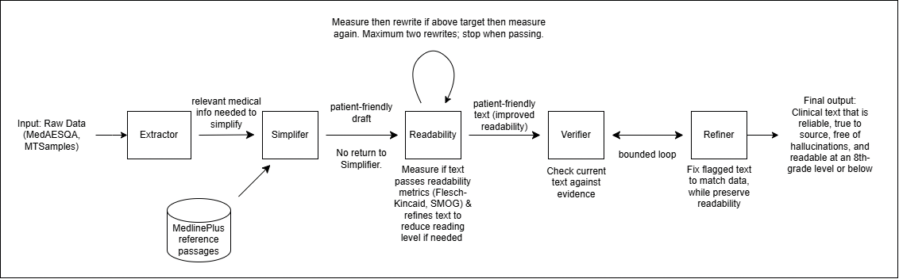

# FaithfulMed: A Multi-Agent System for Faithful, Patient-Friendly Medical Explanations

## Team

| Name             | GitHub handle  | Contribution                                                             |
|------------------|----------------|--------------------------------------------------------------------------|
| Jenna Hunte      | @jehunte       | Break Through Tech Coach                                                 |
| Claudia Jimenez  | @cjimenez909   | Break Through Tech Fellow                                                |
| Hoang Ngo        | @hoangngo-sudo | Break Through Tech Fellow                                                |
| Sarada Varshini  | @saraa-siva    | Break Through Tech Fellow                                                |
| Katelyn Louie    | @katelynlouie  | Break Through Tech Fellow                                                |
| Tionge Kabwe     | @KettyKay      | Break Through Tech Fellow                                                |
| Milka Zekarias   | @MilkaZek      | Break Through Tech Fellow                                                |
| Samuel Tuffour   | @samueltuffour | Break Through Tech Fellow                                                |
| Jaiden Ha        | @jaidenha      | Break Through Tech Fellow                                                |


## The problem

Medical documentation is written by clinicians for other clinicians, not for the patients. When patients leave an appointment with clinical notes filled with dense jargon, they are left to bridge a wide health-literacy gap on their own. Too often, that gap leads to misunderstood care plans, missed medications, and worse health outcomes

LLMs are naturally good at translating complex text into plain English, which makes them an obvious candidate for helping patients understand their own records. The catch is that standard generative models also have a habit of smoothing over uncertainty by inventing details the original note never stated. In casual writing, a small hallucination can be an annoyance; in a patient-facing medical tool, an invented symptom can cause real harm.

## Our solution

FaithfulMed uses five specialized stages. It can skip readability rewrites or factual repairs when the draft does not need them. A finished explanation should be:

1. readable at or below an 8th-grade level;
2. faithful to the source note, with no claim the note does not support;
3. better than a single prompted model on both counts.

## Core research question

> Does a pipeline of specialized agents produce explanations that are both more readable and more faithful than a single well-prompted LLM, and which agents carry that difference?

## The pipeline



## What we built

Google's Agent Development Kit runs the Extractor, Simplifier, and Readability steps in a `SequentialAgent`, followed by a `LoopAgent` with up to two iterations. The stages are custom `BaseAgent` implementations. Each loop iteration starts with the Verifier and runs the Refiner only if the report calls for revision. If the second iteration ends with a repair, that text can exit without another Verifier pass. Reaching the limit does not certify the output.

Before rewriting, the Simplifier pulls reference passages out of a ChromaDB index built from MedlinePlus text and Gemini embeddings. When the note uses a word a patient would not know, the Simplifier has a definition to reach for instead of guessing one.

The Verifier is an LLM judge. The evaluation scripts calibrate it against human-labeled MedAESQA claim/evidence pairs. That measures agreement on the calibration task, not the factual accuracy of an entire rewritten clinical note.

## Setup and installation

### Quick start

To run the Streamlit visualizer:

```bash
# 1. Clone the repository
git clone https://github.com/Break-Through-Tech/Google-2E-faithfulmed-a-multi-agent-system-for-faithful-patient-friendly-medical-explanations.git
cd Google-2E-faithfulmed-a-multi-agent-system-for-faithful-patient-friendly-medical-explanations

# 2. Create a virtual environment (Python 3.11 recommended)
py -3.11 -m venv .venv  # Windows PowerShell
# or
python3.11 -m venv .venv  # macOS/Linux

# 3. Activate and install dependencies
# Windows PowerShell:
& ".\.venv\Scripts\python.exe" -m pip install -r requirements.txt

# macOS/Linux:
./.venv/bin/python -m pip install -r requirements.txt

# 4. Create a .env file containing: GEMINI_API_KEY=your_key_here

# 5. Add the prepared Chroma vector database to chroma/

# 6. Run Streamlit
# Windows PowerShell:
& ".\.venv\Scripts\python.exe" -m streamlit run streamlit_app.py

# macOS/Linux:
./.venv/bin/python -m streamlit run streamlit_app.py
```

The full guide, with commands for each platform and a troubleshooting table, is in [DEMO.md](DEMO.md).

### Requirements

- Python 3.11 or newer.
- A Google AI Studio API key, free tier included: https://aistudio.google.com
- The prepared Chroma vector database, which you request from the team.
- The packages in `requirements.txt`: `google-adk`, `google-genai`, `chromadb`, `streamlit`, `pandas`, `textstat`.

### Important notes

- The visualizer is an experimental prototype, not medical advice.
- Use only fictional or approved de-identified notes. Whatever you paste is sent to the configured model provider.
- Do not commit your `.env` file or API keys.

## Data and datasets

These datasets support development and evaluation.

| Dataset | Purpose | Size | Source |
|---------|---------|------|--------|
| **MedAESQA** | Verifier calibration and faithfulness evaluation | 40 questions, 7,651 evidence excerpts | https://osf.io/ydbzq |
| **MTSamples** | Source clinical documents to simplify | ~5,000 de-identified medical reports | https://www.mtsamples.com/ |
| **MedlinePlus Glossary** | Lay-language medical definitions | Public, free-to-use glossary | https://medlineplus.gov/ |

MedAESQA provides human evidence-relation labels for Verifier calibration. MTSamples provides clinical notes for end-to-end simplification experiments.


## Architecture and agents

### Agents

| Agent | In | Out | What it does |
|-------|-------|--------|------------------|
| **Extractor** | Clinical note | Clinical atoms: facts, types, source quotes | Pulls the facts out of the note and keeps a quote from the note for each one |
| **Simplifier** | Atoms and note | Plain-language draft, reference passages | Rewrites the note, using the retrieved passages for terms a patient would not know |
| **Readability** | Simplifier draft, source note, atoms, and retrieved passages | Selected text and readability report | Measures grade level and attempts up to two rewrites when needed |
| **Verifier** | Current text, source note, atoms, and draft evidence metadata | Faithfulness report and revision decision | Checks claims against evidence and flags issues for revision |
| **Refiner** | Current text, verification report, source note, and atoms | Selected text, changes, and unresolved issues | Makes targeted repairs and rejects a rewrite that would push previously compliant text above the reading target |

### Stack

- Models: See the individual agent modules for their generation and judging settings.
- Orchestration: Google Agent Development Kit (ADK), using `SequentialAgent`, `LoopAgent`, and custom `BaseAgent` steps.
- Retrieval: ChromaDB with `gemini-embedding-2` as the default query embedding model.
- Measurement: `textstat` for Flesch-Kincaid and SMOG, `scikit-learn` for Cohen's κ.
- Front end: Streamlit.
- Code layout: one file per agent in `faithfulmed/agents/`, shared helpers in `faithfulmed/`.


## Results and evaluation

### Targets

These targets come from the [success rubric](SUCCESS_RUBRIC.md).

| Criterion | Good | Moderate | Poor |
|-----------|------|----------|------|
| **Readability:** outputs at or below grade 8 (Flesch-Kincaid) | ≥80% | 50–79% | <50% |
| **Faithfulness:** factual fidelity on the human-annotated test set | ≥85% | 70–84% | <70% |
| **Hallucination rate:** outputs with a clinically meaningful unsupported claim | <10% | 10–20% | >20% |
| **Multi-agent vs. single-agent baseline:** absolute gain in faithfulness score | ≥15 percentage points | 7–14.99 percentage points | 0–6.99 percentage points |
| **Verifier agreement:** agreement with human annotators on faithfulness labels | ≥80% | 70–79.99% | <70% |

The Verifier also has a separate target of Cohen's κ ≥ 0.6.

### Findings

These are placeholders. Each line gets a number when its run finishes.

- Readability: pending the ablation run.
- Faithfulness: pending the comparison against the single-model baseline.
- Hallucination detection: pending the held-out test set.
- Which agent matters most: pending the ablation analysis.
- Model leaderboard: pending, Gemini against Gemma 2 and the external model.

### Artifacts

- An ablation table, one row per removed agent, showing the effect on readability and faithfulness.
- A confusion matrix for the Verifier against the human labels.
- A leaderboard with faithfulness, readability, latency, and cost per model.
- An error analysis of which content goes wrong most often: lab values, drug names, procedures.


## Getting started

### Layout

The tree below matches the repo. File comments say what each file does, not what it might do later.

```
Google-2E/
├── README.md                     # This file
├── DEMO.md                       # Setup, sample notes, troubleshooting
├── Challenge-Project-Overview.md # Full project scope and stretch goals
├── SUCCESS_RUBRIC.md             # Evaluation criteria
├── requirements.txt              # Python dependencies
├── .env                          # Create locally: add GEMINI_API_KEY
├── streamlit_app.py              # Streamlit visualizer
│
├── faithfulmed/                  # Main package
│   ├── agent.py                  # ADK agent definition
│   ├── adk_pipeline.py           # Pipeline orchestration
│   ├── retrieval_utils.py        # Chroma and embedding helpers
│   ├── readability_scores.py     # Readability metrics
│   ├── pipeline_ui.py            # Streamlit UI helpers
│   ├── app.css                   # Visualizer styles
│   ├── icons.py                  # Inline SVG icons
│   ├── medlineplus_aliases.json  # Lay-language term mappings
│   │
│   └── agents/
│       ├── extractor.py          # Clinical fact extraction
│       ├── simplifier.py         # Plain-language rewriting
│       ├── verifier.py           # Faithfulness scoring
│       ├── refiner.py            # Targeted fixes
│       └── readability.py        # Grade-level rewriting
│
├── notebooks/                    # Development and analysis
│   ├── eval_harness.py           # Evaluation framework
│   ├── eda_medaesqa.ipynb
│   ├── medlineplus_eda.ipynb
│   ├── mt_samples_eda.ipynb
│   ├── final-single-gemini-baseline.ipynb
│   └── ...
│
├── data/                         # Datasets
│   ├── README.md
│   ├── medaesqa_v1.json
│   └── retrieval_docs_medlineplus_chunked.jsonl
│
├── evaluation/                   # Calibration scripts and results
│   └── ...
│
└── chroma/                       # Vector database, provided by the team
    └── chroma.sqlite3
```

### Development setup

1. Clone the repo and install the dependencies.

   ```bash
   git clone ...
   cd Google-2E-...
   py -3.11 -m venv .venv
   & ".\.venv\Scripts\python.exe" -m pip install -r requirements.txt
   ```

2. Get an API key. Create one at https://aistudio.google.com and add it to `.env` as `GEMINI_API_KEY=your_key`.

3. Get the Chroma database. Ask the team for the prepared `chroma/` folder and extract it to the repo root. It should contain `chroma.sqlite3` and its companion folders.

4. Run a small test. Start Streamlit with `& ".\.venv\Scripts\python.exe" -m streamlit run streamlit_app.py`, paste the synthetic note from [DEMO.md](DEMO.md#6-try-a-small-test), and check that atoms, grounding, the draft, and a verification report all appear.

5. Watch an agent work in ADK Web.

   ```bash
   & ".\.venv\Scripts\adk.exe" web --host 127.0.0.1 --port 8000
   ```

   Open `http://127.0.0.1:8000` and pick `faithfulmed` from the agent menu.

### Where to read next

[Challenge-Project-Overview.md](Challenge-Project-Overview.md) records the original scope and milestones. [DEMO.md](DEMO.md) covers setup and troubleshooting. [SUCCESS_RUBRIC.md](SUCCESS_RUBRIC.md) lists the project targets.


## License

MIT. See [LICENSE](LICENSE).

## Reading

### Background

- AHRQ and CDC health-literacy material, which is where the 8th-grade target comes from.
- FaithBench and the hallucination-detection work on abstractive summarization.
- The Google ADK docs. LangGraph and CrewAI solve the same orchestration problem differently and are worth a look.
- The MedAESQA, MedQA, and PubMedQA papers, plus anything on Cohen's κ for inter-rater agreement.

### Links

- [Google AI Studio](https://aistudio.google.com): free Gemini API key
- [Google Agent Development Kit](https://google.github.io/adk-docs): ADK Python docs
- [Gemini API docs](https://ai.google.dev): model reference
- [Gemma open models](https://ai.google.dev/gemma): open-weight alternative
- [ChromaDB docs](https://docs.trychroma.com/): the vector store
- [Textstat](https://pypi.org/project/textstat/): readability metrics
- [Hugging Face Spaces](https://huggingface.co/docs/hub/spaces): free demo hosting


## Thanks

Samaneh Kazemi Nafchi, our Challenge Advisor from Google, reviewed the technical work and kept the work pointed at the right problem. Jenna Hunte, our AI Studio Coach at Break Through Tech, mentored the team from the first workplan on.

Google provided the Agent Development Kit, Gemini API access, and the Gemma open models, and framed the challenge around trustworthy AI and equitable access.

Last updated November 2026.
Status: in development, October to December 2026.
Maintainers: @samueltuffour, @cjimenez909, @hoangngo-sudo, @saraa-siva, @katelynlouie, @KettyKay, @MilkaZek, @jaidenha